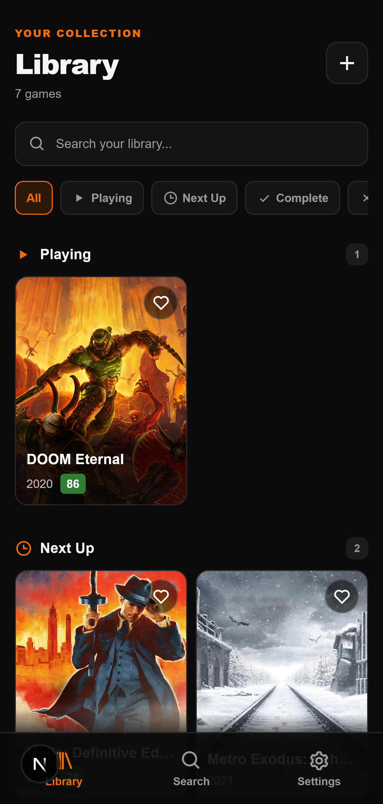
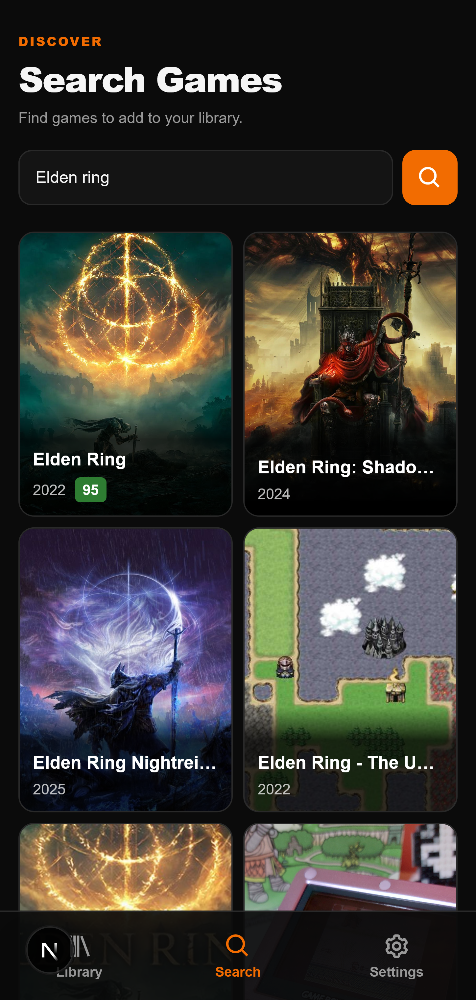
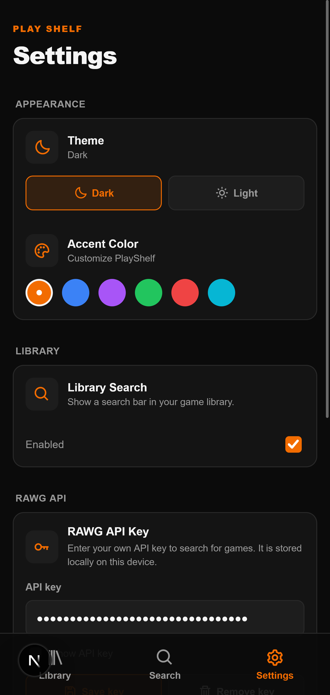

<div align="center">

# PlayShelf

**Your game collection. One shelf.**

A minimalist, open-source game library to organize your collection, manage your backlog, and keep track of your gaming journey.

[](https://github.com/iam-artax/PlayShelf/blob/main/LICENSE)
[](https://github.com/iam-artax/PlayShelf/releases/latest)
[](https://github.com/iam-artax/PlayShelf/releases)
[](https://discord.gg/hcGdTzFpBe)

[Download APK](https://github.com/iam-artax/PlayShelf/releases) · [Report an Issue](https://github.com/iam-artax/PlayShelf/issues) · [Discord Community](https://discord.gg/hcGdTzFpBe)

</div>

---

## Screenshots

<p align="center">
  
  
  
</p>

## Features

- **Game Library** — Keep your game collection organized in one place.
- **Backlog Management** — Track games you're playing, planning to play, completing, or dropping.
- **Favorites** — Mark your favorite games for quick access.
- **Game Search** — Find games through the RAWG Video Games Database API.
- **Local Storage** — Keep your library data on your device without requiring your own database server.
- **Backup and Restore** — Export your library to a JSON backup and restore your data from a backup file.

## Download

Get the latest available Android release from the [GitHub Releases](https://github.com/iam-artax/PlayShelf/releases) page.

1. Download the APK asset attached to a release.
2. Open the downloaded APK on your Android device.
3. If prompted, allow installation from that source and follow the Android installation instructions.


## Game Search and RAWG API Key

PlayShelf uses the [RAWG Video Games Database API](https://rawg.io/apidocs) to search for games.

You need to obtain your own API key from RAWG and enter it in PlayShelf's settings. Game search requires an internet connection.

Your API key is stored locally on your device. Keep it private and do not share it publicly.

## Privacy

- Your game library is stored locally on your device.
- PlayShelf does not require you to run your own remote database server.
- Game searches use the external RAWG API, so search requests are sent to RAWG over the internet.
- Your RAWG API key is stored locally by the app.

Avoid sharing backup files if they contain information you want to keep private.

## Development

### Requirements

- Node.js compatible with the installed Next.js 16.4.0
- pnpm
- Android Studio and the Android SDK for Android development

### Setup

Clone the repository and install dependencies:

```bash
git clone https://github.com/iam-artax/PlayShelf.git
cd PlayShelf
pnpm install
```

Start the development server:

```bash
pnpm dev
```

Create a production web build:

```bash
pnpm build
```

### Android

Build the web app and synchronize it with the native Android project:

```bash
pnpm build
pnpm exec cap sync android
pnpm exec cap open android
```

Use Android Studio to build the Android app. Keep your signing keystore and passwords private; never commit them to Git.

## Tech Stack

- Next.js
- React
- TypeScript
- SurrealDB with IndexedDB storage
- Capacitor
- RAWG Video Games Database API

## Community and Support

Have a question, found a bug, or have an idea?

- [Open an issue on GitHub](https://github.com/iam-artax/PlayShelf/issues)
- [Join the Discord community](https://discord.gg/hcGdTzFpBe)

## License

PlayShelf is licensed under the **GNU General Public License v3.0 only**. See the [LICENSE](LICENSE) file for the full license text.
